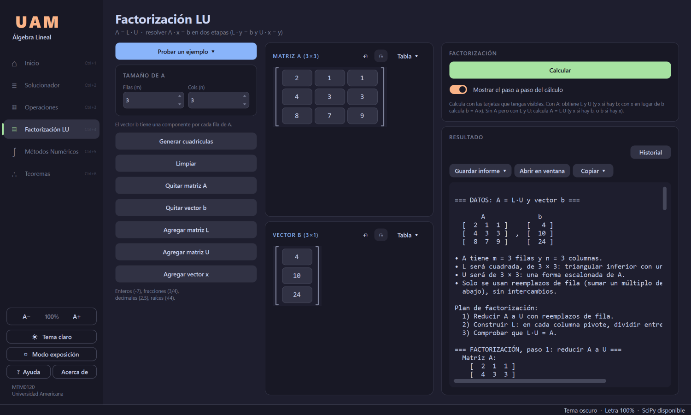
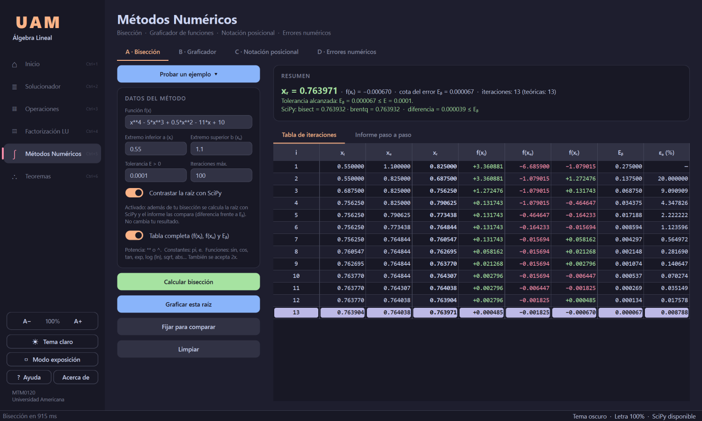
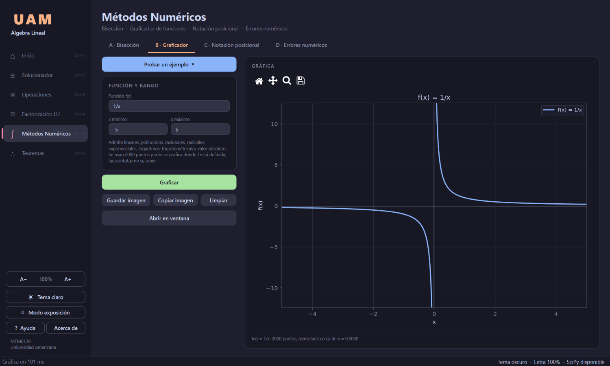

<div align="center">

# Calculadora de Álgebra Lineal

**Resolución de sistemas, operaciones con matrices, factorización LU y métodos numéricos, con el procedimiento completo de cada resultado.**

MTM0120 Álgebra Lineal · Universidad Americana · Facultad de Ingeniería y Arquitectura


</div>

---

## Contenido

1. [Descripción general](#1-descripción-general)
2. [Instalación y ejecución](#2-instalación-y-ejecución)
3. [Módulos de la aplicación](#3-módulos-de-la-aplicación)
4. [Métodos numéricos (Programa 7)](#4-métodos-numéricos-programa-7)
5. [Interfaz y atajos de teclado](#5-interfaz-y-atajos-de-teclado)
6. [Arquitectura del proyecto](#6-arquitectura-del-proyecto)
7. [Decisiones técnicas](#7-decisiones-técnicas)
8. [Validación y seguridad](#8-validación-y-seguridad)
9. [Casos de prueba](#9-casos-de-prueba)
10. [Convenciones de código](#10-convenciones-de-código)
11. [Limitaciones y notas de uso](#11-limitaciones-y-notas-de-uso)
12. [Autores](#12-autores)

---

## 1. Descripción general

Proyecto integrador de la asignatura **MTM0120 Álgebra Lineal**. Implementa las
Unidades I a III del curso (sistemas de ecuaciones, operaciones con matrices y
vectores, propiedades algebraicas, determinantes e inversas), la factorización
LU y el módulo de Métodos Numéricos del Programa 7.

El objetivo no es solo entregar el resultado, sino **explicar el procedimiento**:
cada operación elemental, cada paso de un determinante o cada iteración de la
bisección queda escrito y puede verificarse.

### Características principales

| Área | Capacidad |
|---|---|
| Aritmética | Fracciones exactas (`Fraccion`): sin errores de redondeo en álgebra lineal |
| Sistemas lineales | Gauss y Gauss-Jordan, clasificación por Rouché-Frobenius, variables libres y verificación exacta |
| Matrices y vectores | Suma, resta, producto, transpuesta, escalar, determinante (3 métodos), inversa (2 métodos) y Regla de Cramer |
| Propiedades | Verificación de 31 propiedades algebraicas de las Sesiones 9 a 11 |
| Factorización LU | `A = L·U` para matrices m×n y solución de `A·x = b` en dos etapas |
| Métodos numéricos | Bisección propia, graficador, notación posicional (base 10 y 2) y errores numéricos |
| Teoremas | Catálogo de 30 teoremas con buscador y filtros por categoría |
| Interfaz | Tema claro y oscuro, tamaño de letra ajustable, recorrido guiado, ventana de resultados, sesión persistente |

---

## 2. Instalación y ejecución

### Requisitos

- Python 3.10 o superior.
- Conexión a internet la primera vez, para instalar las dependencias.

### Ejecución

```bash
python main.py
```

La primera vez, el programa comprueba qué librerías faltan (PySide6-Essentials,
NumPy, SciPy y Matplotlib) y las instala todas en una sola pasada, mostrando una
ventana de espera con barra de progreso; las que ya estén no se vuelven a
descargar. El componente gráfico pesa unos 80 MB. Si la instalación automática
fallara, la propia ventana indica el comando exacto y puede hacerse a mano:

```bash
pip install -r requirements.txt
```

### Dependencias

El **álgebra lineal** (Solucionador, Operaciones y Factorización LU) no usa
NumPy, SciPy ni funciones de álgebra lineal de `math`: solo módulos propios.
El módulo de **Métodos Numéricos** admite librerías externas, siempre que no
sustituyan el algoritmo.

| Librería | Uso |
|---|---|
| PySide6-Essentials | Interfaz gráfica y exportación de informes a PDF |
| Matplotlib | Graficador de funciones, incrustado en la ventana |
| NumPy | Muestreo de la gráfica, épsilon de máquina (`numpy.finfo`), overflow y underflow |
| SciPy | Únicamente para **contrastar** la raíz (`scipy.optimize.bisect` y `brentq`); nunca es la solución principal |

El máximo común divisor se implementa con el algoritmo de Euclides en lugar de
`math.gcd`, y toda la lógica se apoya en estructuras nativas: listas anidadas,
condicionales, bucles y funciones.

---

## 3. Módulos de la aplicación

La ventana principal ofrece un menú lateral con cinco herramientas, accesibles
con `Ctrl+1` a `Ctrl+6`.

### 3.1 Solucionador (Gauss / Gauss-Jordan)

1. **Entrada.** Número de ecuaciones y variables (hasta 20×20), coeficientes de
   `A` y términos independientes de `b`. Se aceptan enteros (`-7`), fracciones
   (`3/4`), decimales (`2.5`) y raíces (`√4`, `sqrt(2)`).
2. **Procesamiento.** Operaciones elementales por filas, mostrando la matriz tras
   cada paso junto con la operación aplicada.
3. **Clasificación.** Compara `rango(A)`, `rango([A|b])` y el número de variables.
   En el caso indeterminado identifica las variables libres.
4. **Verificación.** Muestra el valor de cada variable y sustituye la solución en
   el sistema original para comprobar la igualdad de forma exacta.

Opcionalmente continúa hasta la forma escalonada reducida (Gauss-Jordan), donde
cada fila queda como `xᵢ = valor`.

<p align="center">
  
  <br><sub>Solucionador: sistema 3×3 con eliminación paso a paso</sub>
</p>

#### Tres lecturas del mismo sistema

`A·x = b`, la combinación lineal y la independencia lineal son el mismo cálculo
con distinto enunciado. El programa lo resuelve una vez y lo explica de las tres
maneras:

| Enunciado | Sistema que se resuelve | Respuesta |
|---|---|---|
| Ecuación matricial `A·x = b` | `[A \| b]` | Valor de cada `xᵢ` |
| ¿Es `b` combinación lineal de las columnas de `A`? | `[A \| b]` | Los escalares de la combinación, o que no existe |
| ¿Son las columnas de `A` linealmente independientes? | `[A \| 0]` | Solución trivial única (independientes) o una relación de dependencia explícita |

Pueden pedirse desde el solucionador, con la opción *Incluir análisis en Rⁿ*, o
desde Operaciones, con los botones de envío; ambos caminos dan el mismo resultado.
La sección de combinación lineal se omite en sistemas homogéneos, porque `b = 0`
siempre es combinación de cualquier conjunto.

### 3.2 Operaciones con matrices y vectores

**Pestaña Operaciones**

- Suma, resta, producto, transpuesta y multiplicación por un escalar.
- `det(A)`: expansión de cofactores; para 3×3 muestra además la Regla de Sarrus.
- `A⁻¹` por Gauss-Jordan, con verificación `A·A⁻¹ = I`.
- `A⁻¹` por la fórmula de la adjunta, `A⁻¹ = (1/det A) · adj(A)`.
- Regla de Cramer: muestra `det(A)`, cada `Aᵢ` con su determinante y `xᵢ = det(Aᵢ) / det(A)`.
- Opción **Mostrar el paso a paso** para desplegar el desarrollo de todas las operaciones.

**Pestaña Propiedades.** Verifica 31 propiedades (producto matriz-vector, vectores
en Rⁿ, suma y escalar, transpuesta, producto, inversa y determinante). Cada una
calcula los dos lados por caminos distintos y los compara con aritmética exacta;
el diagnóstico es `[Se cumple]` o `[No se cumple]`.

**Pestaña Solucionador.** Envía `[A|b]` al solucionador o resuelve `A·x = b` por Cramer.

El producto `A·x` se presenta de las dos formas habituales: como combinación
lineal de las columnas de `A` y con la regla fila-vector.

### 3.3 Factorización LU

Sección propia (`Ctrl+4`) que trabaja con `A`, `b`, `L`, `U` y `x`. Cada elemento
tiene su tarjeta, que se agrega o se quita, y el botón **Calcular** obtiene lo que
falte con lo que haya a la vista: con `A` calcula `L`, `U` y `x`; con `L` y `U`
reconstruye `A = L·U`; con `b` o `x` obtiene el otro.

- Factoriza cualquier `A` de m×n usando solo reemplazos de fila: `L` guarda los
  multiplicadores y `U` es la forma escalonada. Si hiciera falta intercambiar
  filas, se detiene y avisa que la matriz no admite LU sin permutación (`PA = LU`).
- Si `A` es cuadrada, resuelve `A·x = b` en dos etapas (`L·y = b` y `U·x = y`)
  reduciendo `[L | b]` a `[I | y]` y `[U | y]` a `[I | x]`, y comprueba
  `L·U = A` y `A·x = b` con fracciones exactas.

<p align="center">
  
  <br><sub>Factorización LU con el procedimiento escrito</sub>
</p>

### 3.4 Teoremas

Catálogo de 30 teoremas (sistemas, matrices, determinante, factorización LU y
métodos numéricos) con vista previa, filtros por categoría, búsqueda con `Ctrl+F`,
**Expandir todo** y **Copiar**. El botón **Abrir en…** lleva a la herramienta
correspondiente y señala el botón exacto con una indicación visual.

<p align="center">
  
  <br><sub>Catálogo de teoremas con filtros y buscador</sub>
</p>

---

## 4. Métodos numéricos (Programa 7)

Acceso con `Ctrl+5`. Cuatro pestañas.

### 4.1 Bisección

Programada desde cero en `modulos/modulo_numerico.py`.

**Entradas:** `f(x)`, extremos `a` y `b`, tolerancia absoluta `E > 0` e iteraciones máximas.

**Condiciones iniciales:** `a < b`; `f(a)` y `f(b)` definidas y finitas; raíz exacta
en un extremo (`f(a) = 0` o `f(b) = 0`); y cambio de signo `f(a)·f(b) < 0`. Se
advierte que el cambio de signo no garantiza continuidad, y se detectan asíntotas
como `1/x` en `[−1, 1]`.

**Proceso iterativo.** Cada iteración usa los extremos vigentes *antes* de
actualizar el intervalo:

```text
xᵣ = (a + b) / 2          Eᵦ = (b − a) / 2          fᵣ = f(xᵣ)
si fᵣ = 0           → raíz exacta
si Eᵦ ≤ E           → tolerancia alcanzada
si f(a)·fᵣ < 0      → b = xᵣ
en otro caso        → a = xᵣ
```

**Error y parada.** Se detiene cuando `Eᵦ ≤ E`, cuando `f(xᵣ) = 0` o al alcanzar el
máximo de iteraciones (en cuyo caso avisa que la tolerancia no está garantizada).
Calcula además `Eₐ = |xᵣ,ₖ − xᵣ,ₖ₋₁|` y `εₐ = |(xᵣ,ₖ − xᵣ,ₖ₋₁) / xᵣ,ₖ|`; la primera
iteración muestra «—» y, si `xᵣ,ₖ = 0`, el error relativo se muestra como «No definido».

**Número teórico de iteraciones:** `n = ⌈log₂((b − a)/E)⌉`, proveniente de la cota
`|r − xᵣ,ₙ| ≤ (b − a)/2ⁿ`, comparado con las iteraciones realmente ejecutadas.

**Salidas**

- Tabla de iteraciones con 6 decimales, construida fila por fila con animación.
  La tabla básica contiene `i, xₗ, xᵤ, xᵣ, εₐ (%), f(xᵣ), xᵤ − xₗ`. El interruptor
  **Tabla completa** añade `f(xₗ)`, `f(xᵤ)` y `Eᵦ`, las columnas mínimas de la
  Tarea 7. En ambos casos los extremos se registran antes de actualizar el intervalo.
- Informe paso a paso, con `f(xₗ)`, `f(xᵤ)`, `f(xᵣ)`, `Eₐ`, `εₐ` y `Eᵦ` en cada iteración.
- Resumen con raíz, `f(xᵣ)`, cota del error, iteraciones y veredicto de tolerancia.
- Contraste con SciPy (`bisect` y `brentq`): raíz, `f(raíz)`, iteraciones y diferencia
  absoluta. Coinciden si `|xᵣ − raíz SciPy| ≤ Eᵦ`.
- **Graficar esta raíz** la marca en el graficador, con el intervalo inicial o final.
- **Fijar para comparar** guarda el resultado actual y, al recalcular con otros
  datos (por ejemplo, otra tolerancia), el resumen muestra la diferencia de
  iteraciones y de raíz.

<p align="center">
  
  <br><sub>Bisección con tabla completa y contraste con SciPy (x⁴ − 5x³ + 0.5x² − 11x + 10 en [0.55, 1.1])</sub>
</p>

### 4.2 Graficador de funciones

- Matplotlib incrustado, con 2000 puntos por función.
- Solo grafica donde `f` está definida y no une los puntos a través de asíntotas.
- Título, ejes identificados, cuadrícula y leyenda; la curva se traza con animación.
- Admite varias funciones separadas por `;` (hasta 6).
- Barra de herramientas reducida a lo esencial: **Inicio**, **Mover**, **Zoom** y **Guardar**.
- Admite lineales, polinomiales, racionales, radicales, exponenciales, logarítmicas,
  trigonométricas y de valor absoluto.

<p align="center">
  
  <br><sub>Graficador: f(x) = 1/x sin unir los puntos a través de la asíntota</sub>
</p>

### 4.3 Notación posicional

Descompone un entero en base 10 o base 2 (`dígito · baseᵏ` y la suma), lo convierte
a la otra base por divisiones sucesivas e indica la base de origen y la del
resultado. Verifica que el valor decimal y el binario coinciden. En números
negativos se conserva el signo y se descompone el valor absoluto.

```text
(11110011)₂ = 1·2⁷ + 1·2⁶ + 1·2⁵ + 1·2⁴ + 0·2³ + 0·2² + 1·2¹ + 1·2⁰ = (243)₁₀
```

### 4.4 Errores numéricos

- Punto flotante: por qué `0.1 + 0.2 == 0.3` devuelve `False`, y épsilon de máquina.
- Overflow y underflow, capturando advertencias y resultados no finitos sin
  presentarlos como universales.
- Definición y ejemplo de error inherente, de redondeo, de truncamiento, overflow,
  underflow y error del modelo matemático.
- Error absoluto `Eₐ = |xᵥ − xₐ|`, relativo `Eᵣ = Eₐ / |xᵥ|` y porcentual. Con
  `xᵥ = 0` el relativo se informa como no definido.
- Propagación del error con `f(x) = sen(x) + x²`: `Δy` aproximado `= f′(x)·Δx`,
  `Δy` real y la diferencia entre ambos, indicando que la aproximación es de primer orden.

---

## 5. Interfaz y atajos de teclado

### Atajos globales

| Acción | Atajo |
|---|---|
| Cambiar de herramienta | `Ctrl+1` … `Ctrl+6` |
| Ayuda, atajos y recorrido guiado | `F1` |
| Tema claro / oscuro | `Ctrl+Shift+T` |
| Tamaño de letra | `Ctrl++`, `Ctrl+−`, `Ctrl+0` |
| Modo exposición (pantalla completa y letra grande) | `F11`; `Esc` para salir |
| Salir guardando la sesión | `Ctrl+Q` |

### Atajos por herramienta

| Acción | Atajo |
|---|---|
| Resolver / calcular | `Ctrl+Enter` (en Métodos numéricos, `Enter` en cualquier campo) |
| Limpiar | `Ctrl+L` |
| Deshacer la última limpieza (Métodos numéricos) | `Ctrl+Shift+Z` |
| Graficar la raíz de la bisección | `Ctrl+G` |
| Reproducir / pausar los pasos | `Ctrl+R`; `←` `→` para recorrerlos |
| Guardar informe (.txt) / exportar a PDF | `Ctrl+S` / `Ctrl+P` |
| Determinante, inversa, producto | `Ctrl+D` / `Ctrl+I` / `Ctrl+M` |
| Deshacer / rehacer en una matriz | `Ctrl+Z` / `Ctrl+Y` |
| Pegar una matriz | `Ctrl+V` |
| Buscar | `Ctrl+F` |

### Funciones de la interfaz

- **Recorrido guiado** de 31 pasos la primera vez; se repite desde Ayuda.
- **Validación visible:** la celda inválida se marca en rojo mientras se escribe, con el
  motivo al pasar el cursor, y una franja bajo el título explica el problema. No se
  abren ventanas de error.
- **Sesión persistente:** al cerrar se guardan las cuadrículas, opciones, último
  resultado, tamaño de la ventana y tema; se recuperan al volver a abrir.
- **Ventana de resultados:** informe a color con índice lateral, búsqueda, zoom,
  ajuste de líneas y guardado en `.txt` o PDF.
- **Copiar y pegar:** matrices como tabla (compatible con Excel, Word y PowerPoint) o
  como imagen; en la tabla de la bisección, clic derecho para copiar una fila o toda la tabla.
- **Autocompletado** de funciones (`sin`, `sqrt`, `log`…) en los campos de `f(x)`.
- **Aviso de potencia:** si se escribe `x^3`, se interpreta como potencia y se avisa que
  en Python se escribe `x**3`.
- **Barra de estado** con el tiempo del último cálculo, el tema, el tamaño de letra y la
  disponibilidad de SciPy.
- Las imágenes copiadas siguen el tema activo; los PDF salen siempre en blanco para imprimir.

---

## 6. Arquitectura del proyecto

```text
calculadora-de-matrices/
├── main.py                 Punto de entrada: crea la ventana PySide6
├── instalador.py           Instala en una pasada las librerías que falten (con ventana de espera)
│
├── core/                   Estructuras de datos y álgebra básica
│   ├── fraccion.py           Aritmética exacta con números racionales
│   ├── matriz.py             Matriz aumentada y operaciones elementales
│   ├── algebra.py            Suma, resta, escalar, producto y transpuesta
│   ├── vector.py             Operaciones en Rⁿ
│   ├── procedimiento.py      Paso a paso escrito de cada operación
│   ├── propiedades.py        Verificador de las 31 propiedades algebraicas
│   ├── teoremas.py           Catálogo de 30 teoremas
│   ├── evaluador.py          Evaluador seguro de f(x): AST con lista blanca, sin eval
│   ├── calentamiento.py      Carga anticipada de Matplotlib y SciPy en segundo plano
│   └── formato.py            Construcción de cadenas: matrices, ecuaciones, subíndices
│
├── modulos/                Operaciones sobre matrices y métodos numéricos
│   ├── modulo_matrices.py    Determinante, inversa, cofactores, adjunta y Cramer
│   ├── modulo_lu.py          Factorización LU y solución de A·x = b
│   └── modulo_numerico.py    Bisección, muestreo de la gráfica, notación posicional y errores
│
├── solver/                 Resolución de sistemas
│   ├── clasificacion.py      Clasificación por Rouché-Frobenius
│   ├── eliminacion.py        Forma escalonada y reducida
│   ├── solucion.py           Sustitución regresiva numérica y simbólica
│   ├── independencia.py      Dependencia lineal y relación de dependencia
│   ├── verificacion.py       Sustitución de la solución en el sistema original
│   └── resolutor.py          Coordina el proceso y devuelve el resultado
│
├── output/                 Presentación
│   └── reporte.py            Informe de texto completo
│
└── qt/                     Interfaz gráfica (PySide6)
    ├── ventana_principal.py  Ventana, menú lateral, tema, sesión y barra de estado
    ├── pagina_*.py           Una página por herramienta (inicio, solucionador, matrices,
    │                         LU, numérica y teoremas) sobre pagina_base.py
    ├── grafica.py            Gráfica de Matplotlib animada y su ventana propia
    ├── autocompletar.py      Sugerencias de funciones al escribir f(x)
    ├── componentes.py        Botones, interruptores, tarjetas y cuadrícula de matriz
    ├── render.py, visor.py   HTML de informes y ventana de resultados
    ├── exportar.py, imagen.py  Exportación a PDF e imágenes de informes
    ├── guia.py, tour.py, ayuda.py  Guía de teoremas, recorrido inicial y ayuda
    ├── ejemplos.py, persistencia.py, tema.py, icono.py
    └── ...
```

**Dependencias entre paquetes (sin ciclos):**

```text
qt/  →  output/  →  solver/   →  core/
qt/  →              modulos/  →  core/
qt/  →                           core/
```

`solver/resolutor.py` y `modulos/modulo_matrices.py` no imprimen ni piden datos:
solo calculan y devuelven resultados. La interfaz lee esos resultados, por lo que
no hay riesgo de que muestren cosas distintas.

---

## 7. Decisiones técnicas

**Aritmética racional en lugar de punto flotante.** El algoritmo necesita saber si
un elemento es exactamente cero para elegir pivotes y detectar inconsistencias. En
punto flotante, un valor teóricamente nulo puede quedar en el orden de `1e-17`, lo
que obliga a comparar contra una tolerancia arbitraria y puede clasificar mal. La
clase `Fraccion` hace exacta la comparación con cero, expresa los resultados como
fracciones irreducibles y vuelve estricta la verificación final.

**Tres métodos para el determinante.** Expansión de cofactores (cualquier n ≥ 1),
Regla de Sarrus (solo 3×3) y reducción a forma triangular superior. Los tres dan el
mismo resultado; mostrarlos juntos permite comparar los procedimientos.

**Dos métodos para la inversa.** Gauss-Jordan sobre `[A|I]`, y la fórmula adjunta
(cofactores, transposición y división entre `det A`). Ambos incluyen la verificación
`A·A⁻¹ = I`.

**Intercambio de filas condicionado.** Las filas se permutan solo cuando el pivote
candidato es cero. El pivoteo parcial por mayor magnitud controla el error de
redondeo en punto flotante y carece de utilidad sobre aritmética racional exacta.

**Normalización del pivote.** Cada pivote se divide entre sí mismo; la matriz
escalonada queda con unos en las posiciones pivote y la sustitución regresiva se simplifica.

**Sustitución regresiva simbólica.** En forma escalonada no reducida, cada variable se
representa como `[constante, coef_libre_1, …]` para propagar correctamente los
coeficientes de las variables libres.

**Verificación en el caso indeterminado.** Además de una solución particular, se
sustituye la solución general y se comprueba que los coeficientes de los parámetros
se anulen, de modo que la igualdad vale para cualquier valor de las variables libres.

**Verificación contra el sistema original.** Se conserva una copia intacta previa al
escalonamiento; sustituir en la matriz reducida carecería de valor probatorio.

**Notación con subíndices Unicode.** Las variables se muestran como x₁, x₂… con dígitos
subíndice (₀–₉), lo que permite sistemas de 10 o más variables. En los métodos
numéricos se usan `xₗ`, `xᵤ`, `xᵣ`, `xᵥ`, `xₐ`, `Eₐ`, `Eᵣ`, `Eᵦ` y `εₐ`.

**Carga anticipada sin condiciones de carrera.** Matplotlib y SciPy se importan en un
hilo en segundo plano para que su primer uso no congele la ventana. Quien los
necesita espera antes a que termine, porque dos hilos que importan el mismo paquete a
la vez pueden bloquearse o dejarlo a medio cargar.

**Rendimiento.** Las páginas pesadas se construyen al usarse y el resto se prepara
cuando la aplicación está inactiva. La gráfica anima con *blitting* (redibuja solo la
curva) en unos 5 ms por cuadro.

### Notación de las operaciones elementales

| Operación | Notación |
|---|---|
| Intercambio de filas | `f1 <-> f2` |
| Multiplicar una fila por un escalar | `f1 -> (1/2) * f1` |
| Sumar a una fila un múltiplo de otra | `f3 -> f3 + (-5) * f1` |

Se usan `<->` y `->` en lugar de flechas tipográficas para una representación
uniforme en cualquier codificación de salida.

---

## 8. Validación y seguridad

### Validación de entradas

El programa controla y explica con mensajes claros, permitiendo corregir los datos:
entradas no numéricas, límites incorrectos (`a ≥ b`), tolerancias no positivas,
iteraciones máximas menores que 1, funciones mal escritas, divisiones entre cero,
valores fuera del dominio y campos vacíos. En el graficador se valida además que
`x_min < x_max`; en notación posicional, que los dígitos pertenezcan a la base; y en
errores, que el valor verdadero no sea cero antes de calcular el error relativo.

### Seguridad al evaluar funciones

Las expresiones escritas por el usuario **no se evalúan con `eval()`**. Se convierten a
un árbol de sintaxis (AST) y solo se admiten los nodos de una lista blanca: números,
la variable `x`, las constantes `pi` y `e`, los operadores aritméticos y un conjunto
cerrado de funciones (`sin`, `cos`, `tan`, `exp`, `log`, `sqrt`, `abs`, entre otras).
Cualquier nombre, atributo o llamada fuera de esa lista se rechaza. La implementación
está en `core/evaluador.py`.

---

## 9. Casos de prueba

### Bisección (E = 10⁻⁴, máximo 100 iteraciones)

| Función | Intervalo | n teórico | Resultado |
|---|---|---:|---|
| `x³ − 2x − 5` | [2, 3] | 14 | Raíz ≈ 2.09455 |
| `cos(x) − x` | [0, 1] | 14 | Raíz ≈ 0.73908 |
| `x² − 2` | [1, 2] | 14 | Raíz ≈ 1.41421 |
| `x³ + x − 1` | [0, 1] | 14 | Raíz ≈ 0.68233 |
| `x⁴ − 5x³ + 0.5x² − 11x + 10` | [0.55, 1.1] | 13 | 13 iteraciones, `xᵣ = 0.763971` |
| `x² + 1` | [−1, 1] | — | Rechazado: sin cambio de signo |
| `x² − 1` | [1, 2] | — | Raíz exacta `x = 1` en un extremo |
| `1/x` | [−1, 1] | — | Advierte discontinuidad: el cambio de signo proviene de la asíntota |
| `x³ − 2x − 5`, máximo 5 | [2, 3] | 14 | Avisa que no se alcanzó la tolerancia |

Ejemplo de tabla para `x³ − 2x − 5` en `[2, 3]`:

| i | xₗ | xᵤ | xᵣ | f(xᵣ) | Eᵦ |
|--:|---:|---:|---:|------:|---:|
| 1 | 2.000000 | 3.000000 | 2.500000 | +5.625000 | 0.500000 |
| 2 | 2.000000 | 2.500000 | 2.250000 | +1.890625 | 0.250000 |
| 3 | 2.000000 | 2.250000 | 2.125000 | +0.345703 | 0.125000 |
| … | … | … | … | … | … |
| 14 | 2.094482 | 2.094604 | 2.094543 | −0.000090 | 0.000061 |

### Sistemas lineales

| Sistema | Resultado |
|---|---|
| `2x₁+3x₂+x₃=1` ; `5x₁+3x₂+4x₃=2` ; `x₁+x₂-x₃=1` | Determinado: `x₁=2/3`, `x₂=0`, `x₃=-1/3` |
| `2x₁-3x₂-4x₃=3` ; `3x₁+x₂-x₃=1` ; `x₁+2x₂-3x₃=16` | Determinado: `x₁=-2`, `x₂=3`, `x₃=-4` |
| `2x₁+x₂+x₃=2` ; `x₁-x₂+2x₃=3` ; `3x₁+x₂-x₃=1` | Determinado: `x₁=7/9`, `x₂=-4/9`, `x₃=8/9` |
| `x₂-4x₃=8` ; `2x₁-3x₂+2x₃=1` ; `5x₁-8x₂+7x₃=1` | Inconsistente: `0 = 5/2` |
| `x₁+2x₂+3x₃=6` ; `2x₁+4x₂+7x₃=13` | Indeterminado: `x₁ = 3 - 2x₂`, `x₃ = 1` |
| `x₁+2x₂+3x₃=0` ; `2x₁+4x₂+6x₃=0` ; `x₁+x₂+x₃=0` | Homogéneo indeterminado |

Casos límite verificados: sistema 1×1, matriz nula, más variables que ecuaciones,
filas de ceros, coeficientes fraccionarios y sistemas de hasta 20×20.

---

## 10. Convenciones de código

Se sigue la guía «comentar con criterio» en todos los archivos `.py`:

- **Docstring de módulo** al inicio: propósito técnico, unidad del curso y autores.
- **Docstring por función** de 1 a 3 líneas: qué calcula, qué recibe y qué devuelve.
- **Comentarios de línea solo para el porqué** de una decisión matemática compleja.
- **Nombres autoexplicativos** en lugar de variables genéricas; se conservan `A`, `L`,
  `U`, `b`, `x` donde son la notación matemática del problema.
- **Cero código muerto:** sin funciones, importaciones ni líneas comentadas sin uso.

---

## 11. Limitaciones y notas de uso

- Sistemas de hasta **20×20** variables y matrices de hasta **10×10** en Operaciones.
- Las funciones de la bisección deben ser continuas en el intervalo: el programa
  detecta asíntotas y huecos, pero el cambio de signo por sí solo no prueba continuidad.
- En LU sin permutación, si hace falta intercambiar filas el programa se detiene y lo indica.
- Las preferencias y la última sesión se guardan en la configuración del usuario del
  sistema (en Windows, el registro, bajo `UAM`). **Ayuda → Acerca de → Borrar todos los
  datos** restablece los valores por defecto.
- Al ejecutar, Python genera carpetas `__pycache__` con los módulos compilados; es
  normal y no forma parte de la entrega.

---

## 12. Autores

Anthony Sying González Chow · Jose Maria Moncada Maya · Geanfranco Alexander Rodriguez Mendieta

MTM0120 Álgebra Lineal — Universidad Americana
